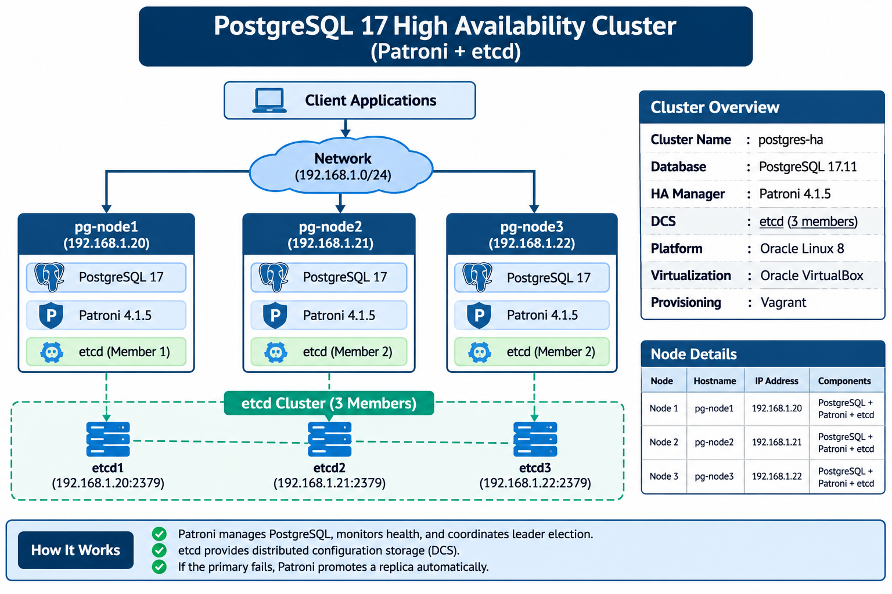

# PostgreSQL 17 High Availability Cluster
## Complete Deployment and Configuration Guide

**Platform:** Oracle Linux 8  
**Virtualization:** Oracle VirtualBox  
**VM Provisioning:** Vagrant  
**Database:** PostgreSQL 17.11  
**High Availability Manager:** Patroni 4.1.5  
**Distributed Configuration Store:** etcd (3 members)  
**Cluster Name:** `postgres-ha`

---

# 1. Overview

This project implements a three-node PostgreSQL High Availability (HA) cluster using Patroni and etcd.

Patroni manages PostgreSQL instances, monitors cluster health, coordinates leader election, and promotes an eligible replica when the current primary becomes unavailable.

The etcd cluster provides distributed configuration storage (DCS), which Patroni uses to coordinate cluster membership and leadership.

### Architecture


### Cluster topology

- pg-node1: Initial PostgreSQL Leader.
- pg-node2: PostgreSQL replica and potential synchronous standby.
- pg-node3: PostgreSQL replica.
- etcd: Three-member distributed configuration cluster.


---

# 2. Create the Virtual Machines Using Vagrant

The Vagrant project directory on the Windows host is:

`C:\Users\User\Documents\postgress`

Create a file named `Vagrantfile` in that directory.

### Vagrantfile

```ruby
Vagrant.configure("2") do |config|

  config.vm.box = "oraclelinux/8"
  config.vm.box_url = "https://oracle.github.io/vagrant-projects/boxes/oraclelinux/8.json"
  config.vm.box_check_update = false

  nodes = [
    { :name => "pg-node1", :ip => "192.168.1.20" },
    { :name => "pg-node2", :ip => "192.168.1.21" },
    { :name => "pg-node3", :ip => "192.168.1.22" }
  ]

  nodes.each do |node|

    config.vm.define node[:name] do |machine|

      machine.vm.hostname = node[:name]

      machine.vm.network "private_network",
        ip: node[:ip]

      machine.vm.provider "virtualbox" do |vb|
        vb.name = node[:name]
        vb.memory = 4096
        vb.cpus = 2
      end

    end

  end

end
```

### Start the virtual machines

Open PowerShell:

```powershell
cd C:\Users\User\Documents\postgress

vagrant up
```

Check VM status:

```powershell
vagrant status
```

Connect to each VM:

```powershell
vagrant ssh pg-node1
vagrant ssh pg-node2
vagrant ssh pg-node3
```

---

# 3. Configure Hostname Resolution

Execute the following on all three VMs.

```bash
sudo hostnamectl set-hostname pg-node1
```

For node2 and node3, change the hostname accordingly.

Add the following block to `/etc/hosts` on all three nodes:

```bash
sudo tee -a /etc/hosts <<'EOF'

# POSTGRES HA HOSTS
192.168.1.20 pg-node1
192.168.1.21 pg-node2
192.168.1.22 pg-node3
# END POSTGRES HA HOSTS
EOF
```

### Verify hostname resolution

```bash
hostnamectl
```

```bash
getent hosts pg-node1
getent hosts pg-node2
getent hosts pg-node3
```

### Verify network connectivity

Run from each node:

```bash
ping -c 4 192.168.1.20
ping -c 4 192.168.1.21
ping -c 4 192.168.1.22
```

All three nodes must be able to communicate with each other.

---

# 4. Install PostgreSQL 17 on All Three Nodes

Perform the following steps on pg-node1, pg-node2, and pg-node3.

### 4.1 Update the operating system

```bash
sudo dnf update -y
```

### 4.2 Install the PGDG repository

```bash
sudo dnf install -y \
https://download.postgresql.org/pub/repos/yum/reporpms/EL-8-x86_64/pgdg-redhat-repo-latest.noarch.rpm
```

### 4.3 Disable the built-in PostgreSQL module

```bash
sudo dnf -qy module disable postgresql
```

### 4.4 Install PostgreSQL 17

```bash
sudo dnf install -y \
postgresql17 \
postgresql17-server \
postgresql17-libs
```

### 4.5 Verify installation

```bash
/usr/pgsql-17/bin/postgres --version
```

Check the PostgreSQL user:

```bash
id postgres
```

### Important: Do not initialize PostgreSQL manually

Do not execute:

```bash
/usr/pgsql-17/bin/postgresql-17-setup initdb
```

Do not start PostgreSQL using the standalone systemd service.

Patroni will initialize the first database instance and create the replicas automatically.

---

# 5. Install etcd on All Three Nodes

This lab uses these endpoints:
```
| Member | IP | Client Port | Peer Port |
|---|---|---|---|
| etcd1 | 192.168.1.20 | 2379 | 2380 |
| etcd2 | 192.168.1.21 | 2379 | 2380 |
| etcd3 | 192.168.1.22 | 2379 | 2380 |
```
### 5.1 Enable the PGDG extras repository

Install the DNF configuration manager if required:

```bash
sudo dnf install -y dnf-plugins-core
```

Enable the RHEL 8 PGDG extras repository:

```bash
sudo dnf config-manager --enable pgdg-rhel8-extras
```

Install etcd:

```bash
sudo dnf install -y etcd
```

Verify:

```bash
etcd --version
etcdctl version
```

### 5.2 Configure etcd
```bash
sudo systemctl cat etcd
```

Check the configuration file or environment file referenced by the service. On the packaged setup, this is commonly `/etc/etcd/etcd.conf`.

The following is the static three-member configuration. Apply the appropriate node-specific values on each VM.

**pg-node1:**

```ini
ETCD_NAME="etcd1"
ETCD_DATA_DIR="/var/lib/etcd/default.etcd"
ETCD_LISTEN_PEER_URLS="http://192.168.1.20:2380"
ETCD_LISTEN_CLIENT_URLS="http://127.0.0.1:2379,http://192.168.1.20:2379"
ETCD_INITIAL_ADVERTISE_PEER_URLS="http://192.168.1.20:2380"
ETCD_ADVERTISE_CLIENT_URLS="http://192.168.1.20:2379"
ETCD_INITIAL_CLUSTER="etcd1=http://192.168.1.20:2380,etcd2=http://192.168.1.21:2380,etcd3=http://192.168.1.22:2380"
ETCD_INITIAL_CLUSTER_STATE="new"
ETCD_INITIAL_CLUSTER_TOKEN="postgres-ha-etcd"
```

**pg-node2:** Change the node-specific values:

```ini
ETCD_NAME="etcd2"
ETCD_DATA_DIR="/var/lib/etcd/default.etcd"
ETCD_LISTEN_PEER_URLS="http://192.168.1.21:2380"
ETCD_LISTEN_CLIENT_URLS="http://127.0.0.1:2379,http://192.168.1.21:2379"
ETCD_INITIAL_ADVERTISE_PEER_URLS="http://192.168.1.21:2380"
ETCD_ADVERTISE_CLIENT_URLS="http://192.168.1.21:2379"
ETCD_INITIAL_CLUSTER="etcd1=http://192.168.1.20:2380,etcd2=http://192.168.1.21:2380,etcd3=http://192.168.1.22:2380"
ETCD_INITIAL_CLUSTER_STATE="new"
ETCD_INITIAL_CLUSTER_TOKEN="postgres-ha-etcd"
```

**pg-node3:** Change the node-specific values:

```ini
ETCD_NAME="etcd3"
ETCD_DATA_DIR="/var/lib/etcd/default.etcd"
ETCD_LISTEN_PEER_URLS="http://192.168.1.22:2380"
ETCD_LISTEN_CLIENT_URLS="http://127.0.0.1:2379,http://192.168.1.22:2379"
ETCD_INITIAL_ADVERTISE_PEER_URLS="http://192.168.1.22:2380"
ETCD_ADVERTISE_CLIENT_URLS="http://192.168.1.22:2379"
ETCD_INITIAL_CLUSTER="etcd1=http://192.168.1.20:2380,etcd2=http://192.168.1.21:2380,etcd3=http://192.168.1.22:2380"
ETCD_INITIAL_CLUSTER_STATE="new"
ETCD_INITIAL_CLUSTER_TOKEN="postgres-ha-etcd"
```

The above configuration assumes the installed etcd systemd service reads `/etc/etcd/etcd.conf`. Verify that with `systemctl cat etcd` before replacing the file.

### Important etcd initialization warning

The `initial-cluster-state=new` setting is for the first creation of this cluster. Once the cluster has been initialized, preserve its data directories and membership.

Do not delete `/var/lib/etcd/default.etcd` or change an existing cluster to a new initial cluster configuration when recovering or restarting it.

### 5.3 Start etcd

After configuring all three members:

```bash
sudo systemctl daemon-reload
sudo systemctl enable etcd
sudo systemctl start etcd
sudo systemctl status etcd
```

### 5.4 Verify etcd cluster health

Run from any one node:

```bash
sudo etcdctl \
--endpoints=http://192.168.1.20:2379,http://192.168.1.21:2379,http://192.168.1.22:2379 \
endpoint health
```

All three endpoints must report healthy.

Check the member list:

```bash
sudo etcdctl \
--endpoints=http://192.168.1.20:2379,http://192.168.1.21:2379,http://192.168.1.22:2379 \
member list
```


**Do not proceed until all three etcd members are healthy.**

---

# 6. Install Patroni on All Three Nodes

### 6.1 Install Patroni packages

```bash
sudo dnf install -y patroni patroni-etcd
#Verify Patroni
patroni --version
```

The `patroni-etcd` package provides the etcd integration required by Patroni.

Check installed packages:

```bash
rpm -qa | grep -E 'patroni|postgresql17'
```

### 6.2 Verify the PostgreSQL binary directory

```bash
ls -l /usr/pgsql-17/bin/
```

### 6.3 Prepare the PostgreSQL data directory

On all three nodes:

```bash
sudo mkdir -p /var/lib/pgsql/17/data

sudo chown -R postgres:postgres /var/lib/pgsql/17

sudo chmod 700 /var/lib/pgsql/17/data

sudo restorecon -Rv /var/lib/pgsql/17
```

The directory must be empty before the initial Patroni bootstrap or replica clone.

### 6.5 Disable standalone PostgreSQL

```bash
sudo systemctl disable --now postgresql-17
```

Patroni must be the only service managing the PostgreSQL process.

---

# 7. Configure Patroni

This is the most important configuration stage.

### 7.1 Configuration parameters
```
| Parameter | Value |
|---|---|
| scope | postgres-ha |
| namespace | /service/ |
| PostgreSQL port | 5432 |
| Patroni API port | 8008 |
| etcd endpoints | 192.168.1.20–22:2379 |
| PostgreSQL data directory | /var/lib/pgsql/17/data |
| PostgreSQL binaries | /usr/pgsql-17/bin |
| Replication mode | Synchronous enabled |
```
### 7.2 Patroni configuration template

Use the following template on each node.

Change only the two variables at the top for the respective node.

```bash
NODE_NAME="pg-node1"
NODE_IP="192.168.1.20"
```

pg-node2:

```bash
NODE_NAME="pg-node2"
NODE_IP="192.168.1.21"
```

pg-node3:

```bash
NODE_NAME="pg-node3"
NODE_IP="192.168.1.22"
```

Now create the configuration using EOF:

```bash
sudo tee /etc/patroni.yml > /dev/null <<EOF
scope: postgres-ha
namespace: /service/
name: ${NODE_NAME}

restapi:
  listen: 0.0.0.0:8008
  connect_address: ${NODE_IP}:8008

etcd3:
  hosts:
    - 192.168.1.20:2379
    - 192.168.1.21:2379
    - 192.168.1.22:2379

bootstrap:
  dcs:
    ttl: 30
    loop_wait: 10
    retry_timeout: 10
    maximum_lag_on_failover: 1048576
    synchronous_mode: true
    synchronous_mode_strict: false

    postgresql:
      use_pg_rewind: true
      use_slots: true
      parameters:
        wal_level: replica
        hot_standby: "on"
        wal_log_hints: "on"
        max_wal_senders: 10
        max_replication_slots: 10
        wal_keep_size: 512MB
        max_connections: 200
        password_encryption: scram-sha-256

  initdb:
    - encoding: UTF8
    - data-checksums

  users:
    admin:
      password: "REPLACE_WITH_STRONG_ADMIN_PASSWORD"
      options:
        - createrole
        - createdb

postgresql:
  listen: 0.0.0.0:5432
  connect_address: ${NODE_IP}:5432
  data_dir: /var/lib/pgsql/17/data
  bin_dir: /usr/pgsql-17/bin

  authentication:
    superuser:
      username: postgres
      password: "REPLACE_WITH_STRONG_POSTGRES_PASSWORD"
    replication:
      username: replicator
      password: "REPLACE_WITH_STRONG_REPLICATION_PASSWORD"

  pg_hba:
    - local all all peer
    - host all postgres 127.0.0.1/32 scram-sha-256
    - host all postgres ::1/128 scram-sha-256
    - host replication replicator 192.168.1.0/24 scram-sha-256
    - host all all 192.168.1.0/24 scram-sha-256

tags:
  nofailover: false
  noloadbalance: false
  clonefrom: false
  nosync: false
EOF
```

**Password requirements:**

- Replace all three password placeholders with strong passwords.
- Use the same PostgreSQL superuser password on all nodes.
- Use the same replication password on all nodes.
- Use the same admin password on all nodes.
- Keep the configuration file permissions restricted.

### 7.3 Set configuration file permissions

Run on each node:

```bash
sudo chown root:postgres /etc/patroni.yml

sudo chmod 640 /etc/patroni.yml
```

### 7.4 Validate Patroni configuration

```bash
sudo -u postgres patroni --validate-config /etc/patroni.yml
```

The command must complete without configuration errors.

---

# 8. Configure the Patroni systemd Service

The installed Patroni RPM service originally referenced:

```text
/etc/patroni/patroni.yml
```

However, the actual configuration file is:

```text
/etc/patroni.yml
```

This mismatch caused the need for a systemd override.

Create the override on all three nodes.

### 8.1 Create the systemd drop-in directory

```bash
sudo mkdir -p /etc/systemd/system/patroni.service.d
```

### 8.2 Create the override file using EOF

```bash
sudo tee /etc/systemd/system/patroni.service.d/override.conf > /dev/null <<'EOF'
[Service]
ExecStart=
ExecStart=/usr/bin/patroni /etc/patroni.yml
EOF
```

### 8.3 Reload systemd

```bash
sudo systemctl daemon-reload
```

### 8.4 Verify the service command

```bash
sudo systemctl show patroni -p ExecStart
```

Expected command:

```text
/usr/bin/patroni /etc/patroni.yml
```

### 8.5 Enable Patroni

```bash
sudo systemctl enable patroni
```

Do not start all three services simultaneously. The initial bootstrap must be performed on pg-node1 first.

---

# 9. Initialize the PostgreSQL Cluster on pg-node1

Start Patroni only on pg-node1:

```bash
sudo systemctl reset-failed patroni

sudo systemctl start patroni
```

### 9.1 Monitor the bootstrap process

```bash
sudo journalctl -u patroni -f
```

Patroni should:

1. Connect to the etcd cluster.
2. Acquire the initial leader lock.
3. Initialize PostgreSQL using `initdb`.
4. Configure PostgreSQL authentication.
5. Start the PostgreSQL server.
6. Complete the post-bootstrap process.
7. Register pg-node1 as the cluster leader.

### 9.2 Verify Patroni status

```bash
sudo systemctl status patroni
```

### 9.3 Verify the cluster

```bash
sudo patronictl -c /etc/patroni.yml list
```

Expected initial topology:

```text
+ Cluster: postgres-ha
| Member   | Host         | Role   | State   |
|----------|--------------|--------|---------|
| pg-node1 | 192.168.1.20 | Leader | running |
```

Do not proceed until pg-node1 is shown as the running Leader.

---

# 10. Join pg-node2 to the Cluster

Connect to pg-node2.

Make sure its Patroni configuration has:

```yaml
name: pg-node2
```

```yaml
restapi:
  connect_address: 192.168.1.21:8008
```

```yaml
postgresql:
  connect_address: 192.168.1.21:5432
```

All other cluster settings and corresponding passwords must match the leader's configuration.

### 10.1 Check the data directory

```bash
sudo ls -la /var/lib/pgsql/17/data/
```

The directory must be empty for a fresh replica.

If there is an existing database from a previous failed attempt, do not delete it blindly. Preserve it and investigate before proceeding. For a disposable lab node where the old data is confirmed unnecessary, rename the directory:

```bash
sudo mv /var/lib/pgsql/17/data \
/var/lib/pgsql/17/data.pre-patroni
```

Then create a fresh directory:

```bash
sudo mkdir -p /var/lib/pgsql/17/data

sudo chown postgres:postgres /var/lib/pgsql/17/data

sudo chmod 700 /var/lib/pgsql/17/data

sudo restorecon -Rv /var/lib/pgsql/17
```

### 10.2 Validate configuration

```bash
sudo -u postgres patroni --validate-config /etc/patroni.yml
```

### 10.3 Start Patroni

```bash
sudo systemctl daemon-reload

sudo systemctl reset-failed patroni

sudo systemctl enable patroni

sudo systemctl start patroni
```

### 10.4 Monitor replica initialization

```bash
sudo journalctl -u patroni -f
```

Patroni should automatically clone the database from pg-node1 and start PostgreSQL as a replica.

### 10.5 Verify from pg-node1

```bash
sudo patronictl -c /etc/patroni.yml list
```

Expected:

```text
+ Cluster: postgres-ha
| Member   | Host         | Role         | State     |
|----------|--------------|--------------|-----------|
| pg-node1 | 192.168.1.20 | Leader       | running   |
| pg-node2 | 192.168.1.21 | Sync Standby | streaming |
```

The exact role assigned to pg-node2 depends on synchronous standby selection.

---

# 11. Join pg-node3 to the Cluster

Connect to pg-node3.

Ensure the node-specific settings are:

```yaml
name: pg-node3
```

```yaml
restapi:
  connect_address: 192.168.1.22:8008
```

```yaml
postgresql:
  connect_address: 192.168.1.22:5432
```

### 11.1 Prepare the PostgreSQL data directory

```bash
sudo ls -la /var/lib/pgsql/17/data/
```

Ensure it is empty before starting a fresh replica.

If it contains old database files, preserve them and investigate before renaming or recreating the directory.

### 11.2 Validate configuration

```bash
sudo -u postgres patroni --validate-config /etc/patroni.yml
```

### 11.3 Configure and start Patroni

```bash
sudo systemctl daemon-reload

sudo systemctl enable patroni

sudo systemctl reset-failed patroni

sudo systemctl start patroni
```

### 11.4 Monitor logs

```bash
sudo journalctl -u patroni -f
```

### 11.5 Verify the complete cluster

Run on pg-node1:

```bash
sudo patronictl -c /etc/patroni.yml list
```

Expected final topology:

```text
+ Cluster: postgres-ha
| Member   | Host         | Role         | State     |
|----------|--------------|--------------|-----------|
| pg-node1 | 192.168.1.20 | Leader       | running   |
| pg-node2 | 192.168.1.21 | Sync Standby | streaming |
| pg-node3 | 192.168.1.22 | Replica      | streaming |
```

---

# 12. Verify PostgreSQL Replication

Connect to PostgreSQL on pg-node1:

```bash
sudo -u postgres /usr/pgsql-17/bin/psql
```

Execute:

```sql
SELECT
    application_name,
    client_addr,
    state,
    sync_state,
    sent_lsn,
    replay_lsn
FROM pg_stat_replication;
```

Check replication lag:

```sql
SELECT
    application_name,
    client_addr,
    state,
    sync_state,
    pg_size_pretty(
        pg_wal_lsn_diff(sent_lsn, replay_lsn)
    ) AS replication_lag
FROM pg_stat_replication;
```

Exit:

```sql
\q
```

### Verify recovery status on replica nodes

Run on pg-node2 and pg-node3:

```bash
sudo -u postgres /usr/pgsql-17/bin/psql -c \
"SELECT pg_is_in_recovery();"
```

Expected:

```text
pg_is_in_recovery
-----------------
t
```

A result of `t` means the PostgreSQL instance is operating as a standby.

---

# 13. Verify Patroni REST API

Patroni exposes a REST API on port 8008.

Check pg-node1:

```bash
curl http://192.168.1.20:8008/
```

Check node health:

```bash
curl http://192.168.1.20:8008/health
```

Check the leader endpoint:

```bash
curl http://192.168.1.20:8008/primary
```

Check replica health:

```bash
curl http://192.168.1.21:8008/replica
```

```bash
curl http://192.168.1.22:8008/replica
```

A successful replica health check confirms that the node is available as a replica. If REST API authentication is configured, supply the appropriate credentials.

---

# 14. Test Automatic Failover

**Perform this test only in a lab environment after confirming that both replicas are healthy.**

The objective is to verify that Patroni can promote an eligible replica if the current leader becomes unavailable.

### 14.1 Confirm the current leader

```bash
sudo patronictl -c /etc/patroni.yml list
```

### 14.2 Stop Patroni on pg-node1

On pg-node1:

```bash
sudo systemctl stop patroni
```

This is a controlled service-stop test, not a production failure simulation.

### 14.3 Monitor the cluster

From pg-node2 or pg-node3:

```bash
sudo journalctl -u patroni -f
```

Check the cluster:

```bash
sudo patronictl -c /etc/patroni.yml list
```

Patroni should elect and promote an eligible replica after the leader lock expires and the failover conditions are satisfied.

### 14.4 Verify the new leader

The cluster should show one new Leader and the remaining healthy node as a replica.

### 14.5 Restart the previous leader

Start Patroni again on pg-node1:

```bash
sudo systemctl start patroni
```

Monitor:

```bash
sudo journalctl -u patroni -f
```

After successful recovery, pg-node1 should rejoin as a replica rather than independently starting as a primary.

**Important:** Do not delete the PostgreSQL data directory or etcd data to perform a failover test.

---

# 15. Important Service Management Commands

### Patroni

Check status:

```bash
sudo systemctl status patroni
```

Start:

```bash
sudo systemctl start patroni
```

Stop:

```bash
sudo systemctl stop patroni
```

Restart:

```bash
sudo systemctl restart patroni
```

Enable at boot:

```bash
sudo systemctl enable patroni
```

View logs:

```bash
sudo journalctl -u patroni -f
```

### etcd

Check status:

```bash
sudo systemctl status etcd
```

Restart:

```bash
sudo systemctl restart etcd
```

View logs:

```bash
sudo journalctl -u etcd -f
```

### Patroni cluster management

List members:

```bash
sudo patronictl -c /etc/patroni.yml list
```

Show cluster configuration:

```bash
sudo patronictl -c /etc/patroni.yml show-config
```

Edit dynamic cluster configuration:

```bash
sudo patronictl -c /etc/patroni.yml edit-config
```

View cluster history:

```bash
sudo patronictl -c /etc/patroni.yml history
```
# 16. Firewall Configuration

In the original lab, firewalld was not running.

If firewalld is enabled in another environment, permit the required traffic between the cluster members.

Example:

```bash
sudo firewall-cmd --permanent --add-port=2379-2380/tcp
sudo firewall-cmd --permanent --add-port=5432/tcp
sudo firewall-cmd --permanent --add-port=8008/tcp

sudo firewall-cmd --reload
```

---

# 17. Final Validation Checklist

Use this checklist after deployment.
```
| No. | Validation | Expected result |
|---|---|---|
| 1 | All VMs running | 3 VMs |
| 2 | Hostname resolution | All nodes resolve |
| 3 | Network connectivity | All nodes communicate |
| 4 | PostgreSQL installation | Version 17.11 |
| 5 | Patroni installation | Version 4.1.5 |
| 6 | etcd health | 3 healthy endpoints |
| 7 | pg-node1 | Leader / running |
| 8 | pg-node2 | Replica / streaming |
| 9 | pg-node3 | Replica / streaming |
| 10 | Replication lag | Within acceptable limits |
| 11 | Patroni REST API | Accessible |
| 12 | Failover test | Successful promotion and recovery |
```
---

